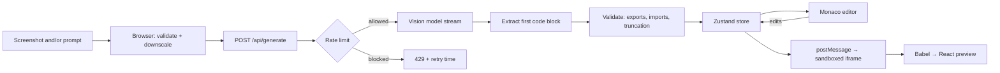

<div align="center">

# ✨ Design → Component Playground

**Turn a screenshot or a plain-English description into a live, editable React + Tailwind component.**

[](https://design-to-component.vercel.app)


</div>

<!--
  Add a screenshot or GIF of the app at docs/screenshot.png, then uncomment:

  <p align="center">
    
  </p>
-->

---

## 📖 Overview

Drop in a screenshot of any UI (or just describe one), and a vision model streams back a
single-file React component styled with Tailwind. It renders instantly in a **sandboxed
live preview**, you can tweak it in a **Monaco editor** with hot reload, and then export it
as a file, a runnable project, or a StackBlitz link.

> **Example prompt:** *"Recreate this pricing section. Make the Monthly/Yearly toggle work
> (yearly saves 20%). Use a violet accent and keep the middle plan highlighted."*

## 🚀 Features

| | |
|---|---|
| 🖼️ **Image or text input** | Drag and drop, browse, or paste a screenshot with `Ctrl + V`. Images are validated and downscaled in the browser before upload. |
| ⚡ **Streaming generation** | Code appears token by token. A **Stop** button cancels mid-stream and keeps what arrived. |
| 🔒 **Sandboxed live preview** | Runs in an opaque-origin iframe with a strict CSP. Mobile, tablet and full-width views. |
| ✏️ **Monaco editor** | TSX highlighting, format on `Ctrl + S`, edits hot-update the preview. Falls back to a plain textarea on touch devices. |
| 🛡️ **Runaway-code protection** | Loop guards inject into every loop, plus a heartbeat watchdog that restarts a frozen preview. |
| 📦 **Three ways to export** | Download `component.tsx`, a complete Vite + React + Tailwind `.zip`, or open it in StackBlitz. |
| 🔑 **Sign in and save** | GitHub sign-in via Supabase. Save, reopen and delete generations from a History drawer. |
| 🚦 **Rate limiting** | 5 generations / 10 min for guests (per IP), 20 for signed-in users (per account). |
| 🧯 **Graceful failures** | Error boundaries per panel, plus clear messages for offline, rate limit, and bad model configuration. |

## 🧠 How it works



1. The browser downsizes the screenshot (max 1568 px, JPEG) and POSTs it with the prompt.
2. The API route verifies the user (if signed in), applies the rate limit, and streams the model's reply.
3. The client pulls the **first fenced code block** out of the stream, even while the fence is half-received, and validates it.
4. The code is sent through `postMessage` to the sandboxed iframe, compiled with Babel, and rendered behind an error boundary.

## 🔐 Security

- **Isolated preview:** the iframe uses `sandbox="allow-scripts"` with *no* `allow-same-origin`, so generated code cannot touch the app's DOM, cookies or storage. Its own CSP blocks network requests.
- **Row-level security:** Postgres policies ensure users can only read and write their own saved generations.
- **Server-side secrets:** the AI key never reaches the browser. The Supabase anon key is public by design and protected by RLS.
- **Verified identity:** access tokens are verified on the server before applying the higher rate limit.
- **Hardened responses:** security headers (`X-Frame-Options`, `nosniff`, `Referrer-Policy`, HSTS, `Permissions-Policy`) on every route.

## 🧰 Tech stack

| Layer | Tools |
|---|---|
| Framework | Next.js 16 (App Router, Turbopack), React 19, TypeScript |
| Styling | Tailwind CSS 4 |
| State | Zustand |
| Editor | Monaco (`@monaco-editor/react`, lazy-loaded) |
| AI | Groq API (vision model, streaming) |
| Auth and DB | Supabase (GitHub OAuth, Postgres with RLS) |
| Rate limiting | Upstash Redis (in-memory fallback locally) |
| Export | `fflate` for client-side zips, StackBlitz form POST |
| Testing and CI | Vitest, ESLint, GitHub Actions |
| Hosting | Vercel |

## 🏁 Getting started

### Prerequisites

- Node.js 20+
- A [Groq](https://console.groq.com) API key (free tier works)
- *(optional)* a [Supabase](https://supabase.com) project and an [Upstash](https://upstash.com) Redis database

### Run locally

```bash
git clone https://github.com/Sudesh-2002/design-to-component.git
cd design-to-component
npm install
cp .env.example .env.local      # then fill in at least GROQ_API_KEY
npm run dev
```

Open [http://localhost:3000](http://localhost:3000).

Supabase and Upstash are **optional locally**. Without them the app runs with no sign-in or
history, and rate limiting falls back to memory.

### Environment variables

| Variable | Required | Purpose |
|---|:---:|---|
| `GROQ_API_KEY` | ✅ | Server-side AI key |
| `GROQ_VISION_MODEL` | ✅ | A vision-capable model your key can use (default `qwen/qwen3.8-27b`) |
| `NEXT_PUBLIC_SUPABASE_URL` | — | Enables sign-in and history |
| `NEXT_PUBLIC_SUPABASE_ANON_KEY` | — | Public Supabase key (protected by RLS) |
| `UPSTASH_REDIS_REST_URL` | — | Distributed rate limiting |
| `UPSTASH_REDIS_REST_TOKEN` | — | Distributed rate limiting |

> **Picking a Groq model.** Groq retires models from time to time. List what your key can use
> (PowerShell), then set `GROQ_VISION_MODEL` to a vision-capable ID from the list:
>
> ```powershell
> $key = ((Get-Content .env.local | Where-Object { $_ -match '^GROQ_API_KEY=' }) -replace '^GROQ_API_KEY=', '').Trim()
> (Invoke-RestMethod https://api.groq.com/openai/v1/models -Headers @{ Authorization = "Bearer $key" }).data.id | Sort-Object
> ```

### Set up sign-in and history (optional)

1. **Database:** run [`supabase/schema.sql`](supabase/schema.sql) in the Supabase SQL editor. It creates the `generations` table with RLS policies.
2. **GitHub OAuth app:** at `github.com/settings/developers` → *New OAuth App*, set the callback URL to `https://<your-project-ref>.supabase.co/auth/v1/callback`. Copy the Client ID and a new Client Secret.
3. **Enable the provider:** Supabase → *Authentication → Sign In / Providers → GitHub* → turn it on and paste the ID and secret.
4. **Allow your URLs:** Supabase → *Authentication → URL Configuration*. Set the Site URL, and add `http://localhost:3000` and your production URL to *Redirect URLs*.

## ☁️ Deploy to Vercel

1. Push the repo to GitHub and import it into [Vercel](https://vercel.com).
2. Add the environment variables above **before** the first deploy. Leave the build settings on their defaults, and skip the optional Supabase/Upstash marketplace integrations if you already created your own.
3. After deploying, add the Vercel URL to Supabase's *Site URL* and *Redirect URLs*.

`NEXT_PUBLIC_*` values are baked in at build time, so redeploy after changing them.

## 📁 Project structure

```
src/
├─ app/
│  ├─ api/generate/route.ts     # Streaming AI route: auth, rate limit, validation
│  ├─ layout.tsx · page.tsx · error.tsx · globals.css
├─ components/
│  ├─ layout/                   # Header, Workspace, auth + history UI, error boundary
│  └─ panels/                   # Input, Preview, Code, editor, export menu, save button
├─ hooks/                       # usePasteImage, useMediaQuery
├─ lib/
│  ├─ export/                   # Zip builder, downloads, StackBlitz launcher
│  ├─ supabase/                 # Browser client, queries, server token check
│  ├─ extract-code.ts           # Streaming-safe code block parser
│  ├─ validate-code.ts          # Export / import / truncation checks
│  ├─ preview-html.ts           # Sandbox document: Babel, loop guard, heartbeat
│  ├─ rate-limit.ts             # Upstash limiter with in-memory fallback
│  └─ ...
├─ store/                       # Zustand: playground, auth, history
└─ types/
supabase/schema.sql             # Table + RLS policies
.github/workflows/ci.yml        # Lint, test, build
```

## 🧪 Scripts

| Command | What it does |
|---|---|
| `npm run dev` | Start the dev server |
| `npm run build` | Production build |
| `npm start` | Serve the production build |
| `npm run lint` | ESLint |
| `npm test` | Vitest unit tests (34) |

## ⚠️ Known limitations

- Generated components may only import from `react`. Icons are inline SVG and images are CSS placeholders.
- Saved history keeps a thumbnail of the screenshot, not the original image.
- The preview loads React, Babel and Tailwind from a CDN, so it needs an internet connection.
- The preview uses Tailwind v3 while the app uses v4. A few v4-only classes won't render in the preview.
- Output quality depends on the vision model, and the same input can produce slightly different code each time.

## 🗺️ Roadmap

- [ ] Store full screenshots in Supabase Storage and restore them on reopen
- [ ] "Iterate" mode: follow-up prompts that edit the existing code
- [ ] Allowlist of extra preview libraries (for example an icon set)
- [ ] Rename and search in History
- [ ] Playwright end-to-end tests for generate → preview → save

## 👤 Author

**Sudesh Hansika**

[](https://github.com/Sudesh-2002)
[](https://linkedin.com/in/sudesh-hansika)
[](https://personal-portfolio-six-smoky-79.vercel.app)

---

<div align="center">

If this project helped you, consider giving it a ⭐

</div>